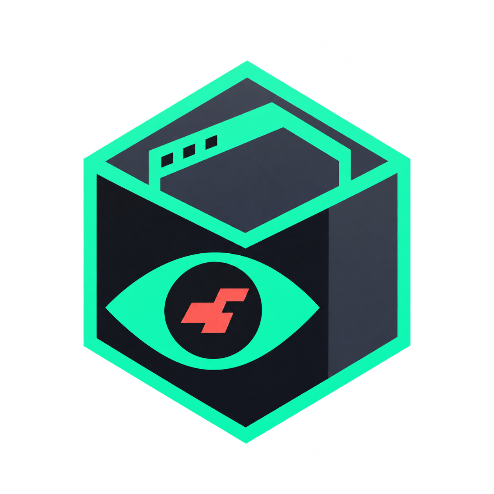
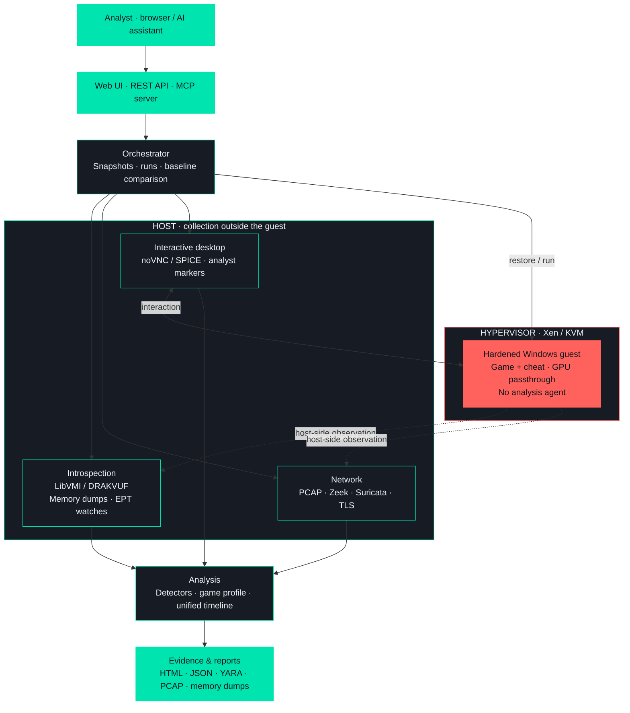

<div align="center">

<a href="#snare">
  
</a>

# Snare

### See exactly how a cheat attacks your game.

Agentless, game-aware cheat analysis.  
Built for game developers and small anti-cheat teams.

[](LICENSE)


**[Why Snare?](#why-snare)** &nbsp; / &nbsp; **[Architecture](#architecture)** &nbsp; / &nbsp; **[Game profiles](#game-profiles)** &nbsp; / &nbsp; **[Roadmap](#roadmap)** &nbsp; / &nbsp; **[Safety](#safety)**

<sub>Observe from the outside. Compare against a baseline. Understand the impact.</sub>

</div>

---

Snare is an open-source analysis sandbox built for game developers and small anti-cheat teams. You run a cheat next to your game inside an isolated virtual machine. Snare watches everything **from outside the VM**: memory, processes, kernel drivers and network traffic. It compares the result against a clean baseline and tells you what the cheat did to *your* game: which functions it hooks, which data it reads or writes, how it gets into memory, and who it talks to.

> [!NOTE]
> **Status: early design.** This README describes the target architecture. The capabilities below are planned, not a list of available features. See the [roadmap](#roadmap) and [detailed implementation plan](./ROADMAP.md).

## At a glance

| Observe | Compare | Understand |
| :--- | :--- | :--- |
| Inspect memory, processes, drivers and traffic **from outside the guest**. | Run the same game with and without the cheat to isolate **what changed**. | Map findings to your game's symbols and data to explain **what the cheat does**. |

<details>
<summary><strong>Explore the design</strong></summary>

- [Core principles](#core-principles)
- [Architecture and analysis flow](#architecture)
- [Game profiles](#game-profiles)
- [Example finding](#example-finding-json)
- [Planned repository layout](#planned-repository-layout)
- [Roadmap](#roadmap)
- [Requirements](#requirements-target)
- [Safety](#safety) and [responsible use](#responsible-use)
- [Contributing](#contributing) and [license](#license)

</details>

---

## Why Snare?

Large studios have dedicated anti-cheat teams and commercial solutions. Small studios usually have nothing: they see cheaters in their game, and that's it. General-purpose malware sandboxes (CAPE, DRAKVUF Sandbox) are powerful, but they don't know anything about your game, and their reports aren't written for game developers.

Snare aims to close that gap. Instead of raw API logs, you get findings like:

- `Weapon::Fire` hooked inline → aim manipulation (silent aim)
- `IDXGISwapChain::Present` hooked via vtable → ESP overlay
- External process reading the player list every frame → wallhack
- Vulnerable signed driver loaded, then an unsigned driver manually mapped into kernel memory
- 2 MB uploaded to an unknown host right after launch → probable stealer bundled with the cheat

---

## Core principles

Every design decision in Snare follows three principles.

### 01 / Stay invisible to the sample

Serious cheats check whether they run in a VM or under analysis, and refuse to work (or behave differently) if they do. Snare is built to give them as little as possible to detect:

- **No agent inside the guest.** All monitoring happens at the hypervisor level. There is no analysis process, driver, hook or injected DLL in the VM for the cheat to find.
- **Hardened VM profile.** Hypervisor CPUID bit and vendor strings hidden, realistic SMBIOS/ACPI tables, disk and NIC models and serial numbers, a non-virtual MAC address prefix, and no guest additions or virtual-device drivers.
- **Real hardware where it matters.** GPU passthrough (VFIO), so the game renders on a real graphics card and no virtual display adapter is exposed.
- **A believable machine.** Realistic CPU core count, RAM and disk size, and an aged user profile (installed software, documents, browser history, uptime).
- **Network capture outside the guest.** Traffic is recorded on the host side, so nothing in the VM reveals it.

Perfect invisibility is not possible (timing side-channels in particular can never be fully hidden). Snare treats anti-detection as an ongoing, measurable effort: the repository will include a test suite of known VM/sandbox detection checks, so every release can show which ones still trigger.

### 02 / Open the guest from the outside

Everything happening inside the VM should be easy to inspect from the host, live or after the fact:

- **Virtual machine introspection (VMI)** through LibVMI / DRAKVUF: processes, threads, loaded modules, memory regions (VAD), handles and kernel drivers, read straight from guest memory.
- **Live and on-demand memory snapshots**: periodic dumps, dumps triggered by events (module load, driver load, new executable memory), or a button in the UI.
- **Fine-grained memory watches**: EPT-based monitoring of specific pages (for example, the game's player list) to see exactly who reads or writes them, without touching the guest.
- **Familiar forensics tooling**: snapshots are compatible with Volatility 3, and can be mounted as a filesystem with MemProcFS.
- **Symbols everywhere**: Windows PDB symbols and the game's own symbols are resolved automatically, so addresses become function names.

### 03 / A complete toolkit, readable by humans and by AI

Snare should cover the whole analysis, from launching the cheat to explaining it, and expose every result in a structured way:

- **Interactive desktop**: the analyst sees and controls the VM in the browser (noVNC/SPICE), to enter a license key, log in to a loader or toggle cheat features, while all collection keeps running. Analysts can drop **markers** ("key entered", "ESP enabled") that appear in the timeline.
- **Network analysis**: full PCAP (open it directly in Wireshark), protocol and flow extraction (Zeek / tshark), signature matching (Suricata), TLS fingerprints (JA3/JA4), and TLS decryption where possible (mitmproxy, or session keys recovered from guest memory).
- **Differential analysis**: every cheat run is compared against a clean run of the same game, so findings only show what the cheat changed.
- **Detectors**: inline / vtable / IAT hooks, injected and manually mapped modules, foreign executable memory, cross-process memory access, suspicious or vulnerable kernel drivers, threads starting outside known modules.
- **Game-aware reports**: map your game's functions and data structures once, and Snare translates low-level findings into cheat behaviour (ESP, aimbot, speed hack…).
- **Unified timeline**: memory, kernel, process and network events on a single timeline.
- **Structured output**: every finding is JSON with a stable schema, plus an HTML report and exportable indicators (YARA rules, byte patterns, network IOCs).
- **AI-ready**: an **MCP server** exposes the analysis to AI assistants (Claude, etc.). An assistant can list processes, read guest memory, query hooks, search the timeline, filter the PCAP or request a disassembly, and explain how the cheat works step by step. AI access is **read-only by default**.

---

## Architecture



<div align="center">
<sub>Mint: observation and evidence &nbsp; · &nbsp; Coral: the isolated sample environment</sub>
</div>

### Analysis flow

| Step | Action | Purpose |
| :--- | :--- | :--- |
| **01** | Restore | Start from a clean snapshot of the hardened guest with the game installed. |
| **02** | Baseline | Run the game alone and record its normal state. |
| **03** | Cheat run | Restore again, then start the game and cheat. Interact with the loader when needed. |
| **04** | Collect | Capture memory, kernel events, traffic and analyst markers throughout the session. |
| **05** | Diff & detect | Compare against the baseline and run the detectors. |
| **06** | Translate | Apply the game profile and build the unified timeline. |
| **07** | Report | Export HTML, JSON, PCAP, memory dumps and indicators; query results through the API or MCP. |

---

## Game profiles

A game profile tells Snare what matters in your game. You write it once per build (or generate it from your symbols):

```yaml
game: MyGame
version: 1.4.2
process: MyGame.exe
symbols: ./symbols/MyGame.pdb

functions:
  - name: Weapon::Fire
    tags: [combat, aim]
  - name: Player::UpdateMovement
    tags: [movement]

data:
  - name: EntityList
    path: "MyGame.exe+0x2A4F10"     # or a symbol name
    tags: [players, positions]
  - name: LocalPlayer.health
    path: "MyGame.exe+0x2A5000 -> 0x1C8"
    tags: [health]

rules:
  - when: read(EntityList) by foreign code
    means: ESP / wallhack
  - when: hook(Weapon::Fire)
    means: aim manipulation
```

---

## Example finding (JSON)

```json
{
  "id": "hook-0007",
  "type": "hook.inline",
  "severity": "high",
  "target": { "module": "MyGame.exe", "symbol": "Weapon::Fire", "rva": "0x1A3F20" },
  "destination": { "region": "0x1F3A0000", "kind": "private_rwx", "module": null },
  "behaviour": "aim manipulation",
  "first_seen": "2026-11-10T18:02:16Z",
  "evidence": ["extracted/4820_0x1F3A0000.bin", "timeline#212"],
  "source": "hooks",
  "confidence": 0.96
}
```

The [finding](./schemas/finding.schema.json) and [event](./schemas/event.schema.json)
schemas are generated with `uv run snare schema export`.

---

## Planned repository layout

```
snare/
├── orchestrator/    # VM lifecycle, snapshots, runs
├── introspection/   # LibVMI / DRAKVUF backends, memory dumps
├── network/         # capture, Zeek / Suricata, TLS handling
├── detectors/       # hooks, injection, drivers, memory access…
├── profiles/        # game profile format and examples
├── report/          # timeline, HTML report, YARA / JSON export
├── mcp/             # MCP server for AI assistants
├── web/             # web UI and interactive desktop
├── stealth/         # VM hardening configs and detection test suite
├── demo/            # demo game + test cheats written for it
└── docs/
```

---

## Roadmap

From an isolated lab to game-aware analysis and AI-assisted investigation. See [ROADMAP.md](./ROADMAP.md) for the detailed plan.

- [ ] **Phase 0: lab.** Hardened Windows guest on KVM/libvirt, snapshot restore, host-side PCAP.
- [ ] **Phase 1: MVP.** Baseline vs. cheat runs, memory dumps, module and executable-memory diff, `Present` and inline hook detection, basic HTML report.
- [ ] **Phase 2: game-aware.** Game profiles, symbol resolution, behaviour classification, unified timeline, JSON findings.
- [ ] **Phase 3: interactive and network.** Browser desktop with markers, Zeek / Suricata, TLS handling.
- [ ] **Phase 4: introspection.** Agentless VMI backend (DRAKVUF / LibVMI), EPT watches, kernel driver analysis.
- [ ] **Phase 5: AI.** MCP server, Ghidra headless integration for disassembly.
- [ ] **Ongoing: stealth.** VM detection test suite, hardening improvements.

---

## Local installation

Install [uv](https://docs.astral.sh/uv/getting-started/installation/), then run
the following in PowerShell from the checkout:

```powershell
.\install.ps1
```

The script installs the locked Python dependencies, verifies `snare --version`
and creates `snare.toml` if needed. Run `.\install.ps1 -WithVolatility` to also
install [Volatility 3](https://github.com/volatilityfoundation/volatility3) as a
separate uv tool for your user. If `vol` is missing from PATH after installation,
run `uv tool update-shell` and reopen PowerShell.

On Linux, run `uv sync --locked` and copy `snare.example.toml` to `snare.toml`
on first setup. On either platform, run `uv run snare config check` to validate
the configuration and list unavailable external tools. Use `--config PATH`
to check a different file. The command exits with status 1 if the file is
invalid or a configured executable is unavailable.

## Requirements (target)

The full analysis lab targets Linux. See the [lab setup guide](./docs/lab-setup.md)
to prepare the host and verify the clean Windows snapshot. Install external tools as you enable their
integrations on the analysis host. Use the official instructions for
[MemProcFS](https://github.com/ufrisk/MemProcFS/releases),
[Zeek](https://docs.zeek.org/en/lts/install.html) and
[Suricata](https://docs.suricata.io/en/latest/install.html). Add their commands
to PATH or provide executable paths in `snare.toml`.

- Linux host with hardware virtualization (Intel VT-x with EPT recommended; the DRAKVUF backend requires Intel)
- KVM/libvirt (first backend), Xen (introspection backend)
- A spare GPU for passthrough (recommended for games)
- Windows 10/11 guest image
- Python 3.11+

---

## Safety

> [!WARNING]
> Cheats frequently bundle stealers, RATs and miners. Treat every sample as live malware.

- Run Snare on a **dedicated analysis host**, never on your daily machine.
- The guest must **never reach your local network**. When a loader needs internet access, route the guest through a **dedicated VPN**, never your studio's IP.
- Use a **"cut" mode** (no network or simulated services) whenever the analysis doesn't need the real internet.
- Never put real credentials in the guest (Steam, Discord, browsers).
- License keys are often bound to hardware IDs. Use keys dedicated to analysis.

## Responsible use

Snare is a **defensive** tool: it exists to help developers understand and stop cheats.

- This repository does **not** and will **never** host cheat samples. The only "cheats" included are minimal test programs written against the bundled demo game, used to validate the detectors.
- Detection signatures produced from real cheats belong to the studios that run Snare, not to this repository.
- Contributions that help cheats evade detection, or that target real games' anti-cheat systems, will not be accepted.

## Contributing

Contributions are welcome, especially new detectors, engine integrations (Unity / IL2CPP, Unreal, Godot), stealth improvements, and documentation. Please open an issue to discuss larger changes first.

## License

[Apache License 2.0](LICENSE). Third-party tools Snare integrates with (Volatility 3, DRAKVUF, LibVMI, Zeek, Suricata…) keep their own licenses and are used as external dependencies.


---

<div align="center">

**SNARE** · Observe. Compare. Understand.

[Back to top ↑](#snare)

</div>
